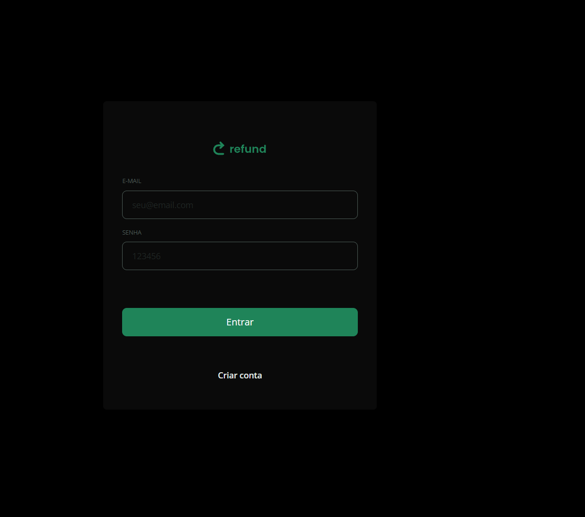
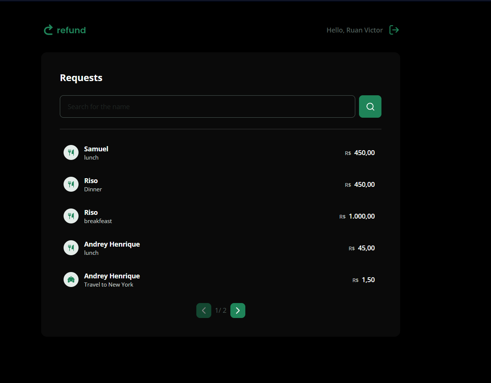
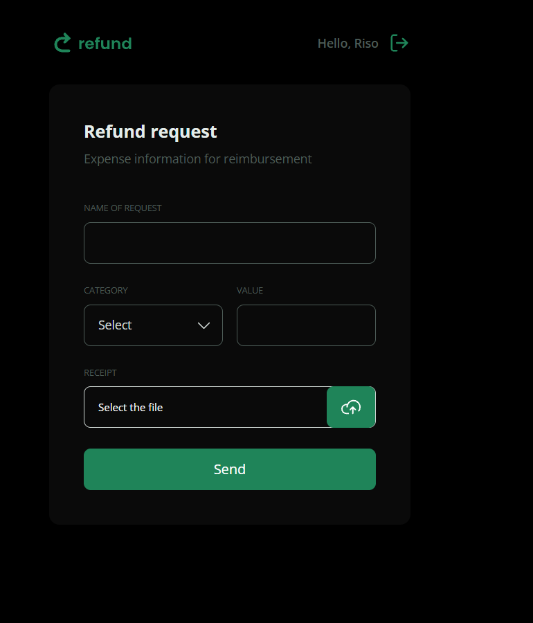

# Refund — Sistema de solicitação de reembolsos

Aplicação web para registrar e consultar solicitações de reembolso, com autenticação de usuários e separação de permissões por perfil. O projeto é composto por uma interface React e uma API REST desenvolvida com Node.js e Express.

> **Status:** projeto em desenvolvimento. As funcionalidades e os comandos abaixo foram documentados com base nos arquivos enviados; revise os pontos marcados antes de publicar o repositório.

## Demonstração

Adicione capturas de tela reais da aplicação na pasta `docs/screenshots/` e atualize os caminhos abaixo:

<!-- Sugestão de arquivos: docs/screenshots/login.png, dashboard.png e new-refund.png -->

| Login | Dashboard | Solicitação de reembolso |
|---|---|---|
|  |  |  |


## Funcionalidades

Com base nas páginas, rotas, controladores e middlewares presentes no código:

- Cadastro e autenticação de usuários.
- Controle de acesso por perfil: `employee` e `manager`.
- Criação e consulta de solicitações de reembolso.
- Registro de valor, descrição/nome, categoria e nome do arquivo de comprovante.
- Upload e armazenamento de arquivos no servidor.
- Listagem de reembolsos com pesquisa e paginação na interface.
- Formatação de valores monetários e apresentação de categorias.
- Tratamento de rotas não encontradas e estados de carregamento.

A lista descreve recursos indicados pela estrutura do código. Confirme o comportamento completo de cada item antes de considerar a aplicação pronta para produção.

## Tecnologias

### Frontend

- [React](https://react.dev/) 19
- [TypeScript](https://www.typescriptlang.org/)
- [Vite](https://vite.dev/)
- [React Router](https://reactrouter.com/)
- [Tailwind CSS](https://tailwindcss.com/) 4
- [Axios](https://axios-http.com/)
- [Zod](https://zod.dev/)
- `clsx` e `tailwind-merge` para composição de classes

### Backend

- [Node.js](https://nodejs.org/)
- [Express](https://expressjs.com/) 5
- [TypeScript](https://www.typescriptlang.org/)
- [Prisma ORM](https://www.prisma.io/) 7
- SQLite
- [JSON Web Token](https://jwt.io/) para autenticação baseada em token
- [bcrypt](https://github.com/kelektiv/node.bcrypt.js) para hash de senhas
- [Multer](https://github.com/expressjs/multer) para upload de arquivos
- [Zod](https://zod.dev/) para validação
- CORS

## Estrutura do projeto

A estrutura abaixo representa os diretórios identificados nos arquivos enviados. Ajuste os nomes de diretório se o seu repositório usar outra organização.

```text
refund/
├── frontend/
│   ├── public/
│   ├── src/
│   │   ├── assets/
│   │   ├── componentes/
│   │   ├── context/
│   │   ├── dtos/
│   │   ├── hooks/
│   │   ├── pages/
│   │   ├── routes/
│   │   ├── services/
│   │   └── utils/
│   ├── package.json
│   ├── tsconfig.json
│   └── vite.config.ts
└── backend/
    ├── prisma/
    │   └── schema.prisma
    ├── src/
    │   ├── configs/
    │   ├── controllers/
    │   ├── database/
    │   ├── middlewares/
    │   ├── providers/
    │   ├── routes/
    │   ├── types/
    │   └── utils/
    ├── package.json
    └── prisma.config.ts
```

## Modelo de dados

O schema Prisma define dois modelos principais:

- **User:** `id`, `name`, `email`, `password`, `role`, `createdAt` e `updatedAt`. O e-mail é único e o perfil padrão é `employee`.
- **Refunds:** `id`, `name`, `amount`, `category`, `fileName`, `userId`, `createdAt` e `updatedAt`. Cada reembolso pertence a um usuário.

Perfis definidos: `employee` e `manager`.

Categorias definidas no schema: `food`, `others`, `services`, `transport` e `accomodation` (grafia usada no schema do projeto).

O banco configurado no schema é SQLite. A URL de conexão é lida da variável `DATABASE_URL` pelo `prisma.config.ts`.

## Pré-requisitos

- Node.js e npm instalados.
- Git, caso vá clonar o repositório.
- Um terminal na pasta do frontend ou do backend.

Confira a versão instalada:

```bash
node --version
npm --version
```

## Como executar localmente

Os arquivos enviados contêm dois `package.json`, um para cada parte da aplicação. Os exemplos abaixo pressupõem que o frontend e o backend estejam em pastas separadas.

### 1. Backend (API)

Entre na pasta do backend e instale as dependências:

```bash
cd backend
npm install
```

Crie um arquivo `.env` na pasta do backend e configure a variável usada pelo Prisma. Para uma base SQLite local, um exemplo comum é:

```env
DATABASE_URL="file:./dev.db"
```

Gere o cliente Prisma e inicie a API:

```bash
npm run generate
npm run dev
```

O script `dev` informado no `package.json` executa `tsx watch src/server.ts`. O `package.json` enviado não define scripts de migração; caso precise criar/aplicar migrações, confira a configuração da versão do Prisma instalada e o fluxo utilizado no projeto.

> O endereço/porta da API não foi confirmado nos arquivos de configuração visíveis. Consulte `src/server.ts` e a configuração de ambiente para saber a URL local exata.

### 2. Frontend

Em outro terminal, entre na pasta do frontend e instale as dependências:

```bash
cd frontend
npm install
npm run dev
```

O Vite exibirá no terminal o endereço local da aplicação.

Para verificar se o frontend compila para produção:

```bash
npm run build
```

Para executar o ESLint:

```bash
npm run lint
```

O frontend utiliza um serviço Axios para se comunicar com a API. Confira `src/services/api.ts` e configure o endereço base da API conforme o ambiente local. Não foi identificado, nos arquivos de configuração enviados, um nome confirmado para a variável de ambiente do frontend.

## Segurança e configuração

- Não versione o arquivo `.env` nem credenciais, tokens ou senhas reais.
- Se necessário, disponibilize um `.env.example` com os nomes das variáveis e valores fictícios.
- Use senhas de demonstração apenas em ambiente local.
- Verifique as regras de validação e os limites de tamanho/tipo de arquivo antes de publicar a API.

## Próximas melhorias

Itens que podem ser considerados para evolução, caso ainda não estejam implementados:

- Adicionar testes automatizados para frontend e API.
- Documentar os endpoints com exemplos de requisição e resposta.
- Adicionar capturas de tela reais e link da aplicação publicada.
- Documentar a configuração de produção e o processo de deploy.
- Criar um `.env.example` e instruções reproduzíveis para preparar o banco de dados.

## Autor

**Ruan Victor**

- GitHub: [adicione aqui o link do seu perfil]

---

Se você encontrar algum problema ao executar o projeto, confira primeiro as versões do Node.js, as variáveis de ambiente e as instruções de configuração do Prisma.
